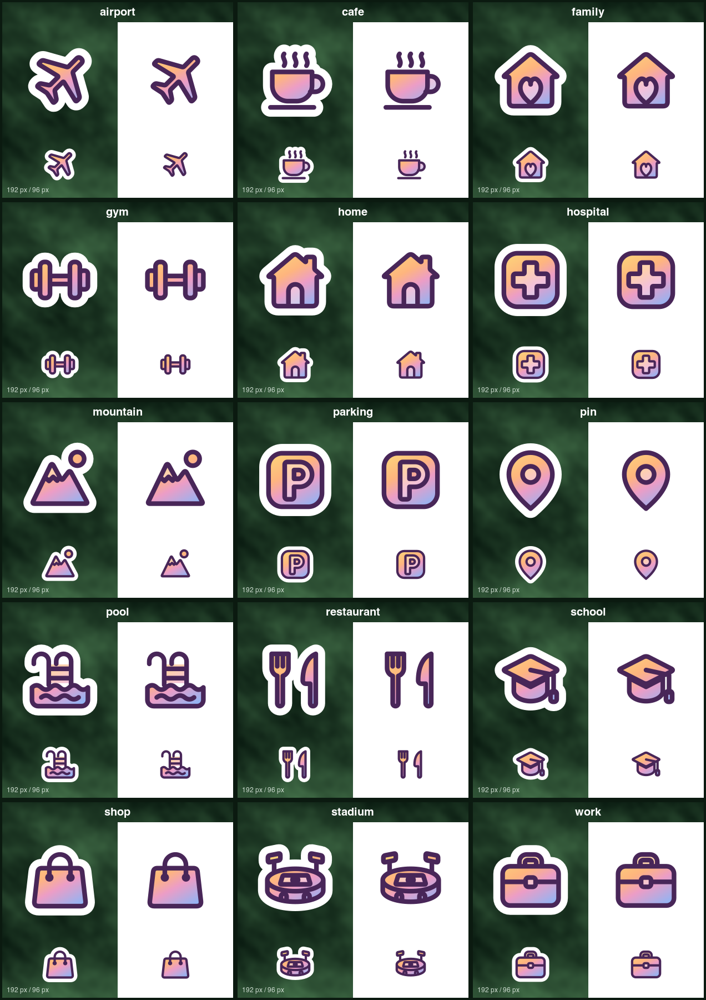

# Own icon set (Sticker style)

Destination icons drawn for this app, in the style of Niagara Launcher's "Sticker" Anycons with the
Coral palette (decision 1.6 in `docs/decisions.md`). Android VectorDrawables, no bitmaps.



## Icons

| Resource | Shows |
|---|---|
| `ic_own_home` | house with chimney and door |
| `ic_own_work` | briefcase |
| `ic_own_gym` | dumbbell |
| `ic_own_stadium` | oval arena with pitch, gates and floodlights |
| `ic_own_school` | graduation cap |
| `ic_own_pool` | pool ladder over water |
| `ic_own_shop` | shopping bag |
| `ic_own_restaurant` | fork and knife |
| `ic_own_pin` | location pin |
| `ic_own_hospital` | rounded square with a cross |
| `ic_own_airport` | aeroplane |
| `ic_own_parking` | rounded square with a P |
| `ic_own_cafe` | steaming cup on a saucer |
| `ic_own_family` | house with a heart |
| `ic_own_mountain` | mountains with snow line and sun (hiking) |

All live in `app/src/main/res/drawable/`. They are **generated**: edit the glyph definitions in
`tools/gen_icons.py` and run `python3 tools/gen_icons.py`, never edit the XML by hand.

## Recipe

Every icon has a 24×24 viewport and one group scaled 0.7 around (12, 12). The glyph is drawn on
the 24 grid within about 3–21 units. Inside the group, bottom to top:

1. **sticker**: the glyph silhouette and outline subpaths, filled white and stroked white
   6 units with round joins. After scaling this is a ~2.1-unit die-cut margin; the outermost
   point stays ≥ 3.4 units inside the viewport edge, so nothing clips.
2. **bg**: the silhouette, filled with the coral gradient at 63 % alpha (`fillAlpha="0.63"`).
3. **fg**: the silhouette with detail regions cut out (door, cross, P, heart, pin hole, pitch,
   snow cap…, `fillType="evenOdd"`), filled with the same gradient at 100 %. Cut-outs therefore
   show the paler bg fill.
4. **outline**: silhouette edge plus interior detail lines, 1.5 units (≈1.05 after scaling),
   round caps and joins, `@color/icon_sticker_outline`.

The gradient is a linear gradient inlined with `<aapt:attr name="android:fillColor">`, from
(7, 3) to (17, 21) in the glyph's own coordinates (top-left to bottom-right, mostly top to
bottom), with four stops. It approximates Niagara's coral texture: warm yellow/orange at the
top, pink in the middle, sky blue at the bottom. Every path is under 650 characters (lint's
`VectorPath` limit is 800).

## Palette

`app/src/main/res/values/colors_icons.xml`:

| Resource | Value | Use |
|---|---|---|
| `icon_sticker_outline` | `#482658` | outline (Niagara Coral's stroke colour) |
| `icon_sticker_background` | `#FFFFFF` | die-cut sticker |
| `icon_sticker_grad_1` | `#FCD27A` | gradient stop 0 (warm yellow) |
| `icon_sticker_grad_2` | `#FEB57E` | gradient stop 0.35 (orange) |
| `icon_sticker_grad_3` | `#EC9DC6` | gradient stop 0.6 (pink) |
| `icon_sticker_grad_4` | `#8DB5F5` | gradient stop 1 (sky blue) |

Changing a colour here re-themes the whole set. `@color` references inside the inline gradient
`<item>`s are accepted by aapt2: it extracts each inline gradient into a generated
`$ic_own_<name>__N` colour resource, and the compiled `<item android:color>` keeps the reference
(checked with `aapt2 dump xmltree`). The exact palette still has to be matched against the
user's phone (PLAN step 5.2).

Both the drawables and the palette carry `tools:ignore="UnusedResources"`. They are a picker
set and may be resolved by name, so lint cannot always see them as used.

## Preview

```sh
tools/render-icons-preview.sh            # writes docs/icons-preview.png
```

This needs `python3` (stdlib only), `rsvg-convert` (librsvg) and ImageMagick 7 (`magick`).
For each `ic_own_*.xml` the script:

- converts the drawable to SVG with `tools/vd2svg.py`;
- renders it at 192 px and 96 px, both on a generated dark-green, blotchy "forest"
  background and on white;
- labels it, then montages all cells (3 per row) into one contact sheet (about 440 KB).

`tools/vd2svg.py` is a general VectorDrawable → SVG converter. It handles:

- groups: scale, pivot, translate and rotation;
- paths: fill, stroke, alphas, caps and joins, miter limit, `fillType`;
- clip paths;
- inline linear and radial gradients (`gradientUnits="userSpaceOnUse"` inside the transformed
  group, as on Android);
- `@color` references, resolved from `res/values/*.xml`.

Usage: `python3 tools/vd2svg.py file.xml [-o out.svg] [--size PX]`.

## Licence

- All glyphs are our own drawings, made from simple geometry (rounded polygons, rounded rects,
  arcs, circles) in `tools/gen_icons.py`. They are part of this project and under its licence.
- **No Material Symbols paths were used** for this set. (The separate fallback
  `ic_place_pin.xml` is Material Icons "location_on", Apache License 2.0, Google; it is not
  part of this set.)
- **No Niagara art was copied.** Niagara's Anycons (`bitpit.launcher`) were inspected for the
  *style* only: the layer recipe, 0.7 scale, stroke widths, outline colour, and the hues of
  the coral texture, approximated by eye. No path data, textures or other assets from the
  Niagara APK are in this repository.
